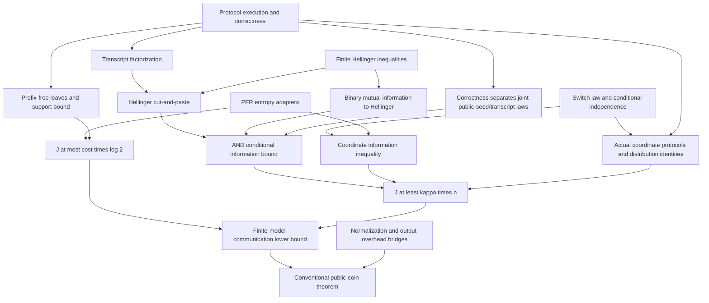

# BJKS proof blueprint

Status: proposed mathematical interfaces. Only results explicitly listed as checked in
`status.md` are verified. This document does not declare any Lean axioms.

The protocol and finite endpoint definitions below compile in `Protocol.lean`
and `Target.lean`. Phase 2 has checked structural protocol theorems, transcript
factorization/support, and a zero-error send-input example. The endpoint remains unproved.

## Endpoint and protocol model

For `Bits n := Fin n → Bool`, `disj x y` is true iff no coordinate is true in both inputs.
The finite-model endpoint is:

> There exist real `a > 0` and natural `n₀` such that for every `n ≥ n₀`, every
> finite nonempty public seed type `R`, private seed types `SA` and `SB`, every
> probability law `ρ : PMF R`, `α : PMF SA`, `β : PMF SB`, and every protocol `Π`
> described below, pointwise error at most `1/3` implies `a * n ≤ cost Π`.

The constants are chosen before all input dimensions, seed types, laws, and protocols.
Seed cardinalities and probabilities are unrestricted. Real-valued arbitrary finite
probabilities are allowed; no bound on random bits is imposed.

Executable representation:

```text
Tree A B
  leaf(output : Bool)
  alice(nextBit : A → Bool, zeroChild : Tree A B, oneChild : Tree A B)
  bob(nextBit : B → Bool, zeroChild : Tree A B, oneChild : Tree A B)

Π : R → Tree (Bits n × SA) (Bits n × SB)
```

The public seed chooses the tree. Each branch transmits exactly one bit. Local
decision functions may depend arbitrarily on the player's input, private seed, and
history, since the history is determined by the node. The next speaker and whether
communication has ended are publicly determined by the tree and transcript; silent
private signaling is not part of this model. The output is the leaf label.

Execution samples `(r, sA, sB)` under the product law `ρ × α × β`, independently of
the input and the analysis switches. The transcript is the bit path. Proposed cost
is the maximum tree depth over public seeds, counting even unreachable branches.
The latter requires a bridge: trim unreachable branches or represent a conventionally
cost-`c` protocol by a tree of depth at most `c`. Do not equate this definition with
maximum reachable length without proving the bridge. Zero-mass seeds can be removed
when a conventional cost bound only applies on their support.

`Correct Π f ε` means that **for every input pair** `(x,y)`, the probability of an
incorrect leaf label is at most `ε`. This includes intersecting inputs.

The conventional public-coin endpoint additionally requires a normalization theorem.
For finite input sets and bounded communication there are finitely many deterministic
communication behaviors. The proposed route is to group arbitrary random tapes by
their induced behavior, yielding a finite law without increasing cost or error.
Formalize the source protocol/tape model and this map before claiming coverage.
Turning private tapes into additional public tapes preserves execution behavior when
the players ignore the newly visible tapes, but the relevant simulation also needs
a proof. This is an open obligation, not a normalization assumption.

If only a designated player knows the answer in a source model, transmit its answer
as one additional bit. Then absorb the additive one into a smaller linear constant
and an explicit threshold. Our primary tree model already has a public leaf output.

## Distribution and information

For each coordinate independently, choose fair bits `(Dᵢ,Uᵢ)` and set

```text
Dᵢ = false: (Xᵢ,Yᵢ) = (false,Uᵢ)
Dᵢ = true:  (Xᵢ,Yᵢ) = (Uᵢ,false).
```

Thus `(0,0),(0,1),(1,0),(1,1)` have probabilities `1/2,1/4,1/4,0`.
This law is a definition; its support and independence properties must be proved.
Use finite `PMF` sampling and `PMF.toMeasure` to supply PFR's random-variable API.
The full sample space also contains independent public and private protocol seeds.

Define `J Π := condMutualInfo (X,Y) T (D,R) μ`, in natural logarithm units.
`D` is never an argument of original protocol execution. In particular, revealing
the whole switch vector to the original protocol would change the theorem.

Zero-probability conditioning events contribute zero to the finite conditional
information sum. PFR's conditioning convention handles them via the zero measure.
Probability-measure hypotheses remain explicit at every use of entropy identities.

## Dependency graph



## Required statements and available interfaces

| Step | Precise obligation | Source / implementation status |
| --- | --- | --- |
| Entropy | Chain and conditional chain rules, nonnegative conditional information | PFR `chain_rule`, `cond_chain_rule`, `condMutualInfo_nonneg` |
| Averaging | `I(X;Y\|Z) = Σ_z Pr[Z=z] I(X;Y under Z=z)` | PFR `condMutualInfo_eq_sum'` |
| Re-expression | `I(X;Y\|Z) = H(X\|Z) - H(X\|Y,Z)` | PFR `condMutualInfo_eq'` |
| Conditional subadditivity | `H(A,B\|Z) ≤ H(A\|Z)+H(B\|Z)` | Two-variable adapter checked in `Integration.lean`; finite-family extension remains |
| Independent coordinates | `H((Xᵢ,Yᵢ)ᵢ\|D,R) = Σᵢ H(Xᵢ,Yᵢ\|D,R)` | Prove law/conditional independence; adapt PFR results |
| Law invariance | Joint-law equality preserves the information quantities used in embeddings | PFR entropy/conditional-entropy `IdentDistrib` results; conditional information adapter needed |
| Rectangle structure | For fixed `r,t`, the execution fiber in augmented inputs is a rectangle | Checked: `Tree.run_transcript_eq_iff` |
| Factorization | `Pr[T=t\|x,y,r] = A(r,t,x) B(r,t,y)` | Checked: `Protocol.privateTranscriptLaw_factorization` and joint-law identity |
| Support | For each `r`, possible leaf transcripts number at most `2^(cost Π)` | Checked: `Protocol.privateTranscriptLaw_support`, `Protocol.card_leafPaths_le_cost` |
| Communication bound | `J Π ≤ cost Π * log 2` | Average support entropy bounds for each `r`; do not bound the entire `(R,T)` alphabet |
| AND statistics | Cut-and-paste, distance inequalities, and binary information bound | New finite analytic layer, using mathlib where possible |
| Embedding | A valid AND protocol for each coordinate, with exact law and information identities | New construction using public other-coordinate switches and private padding |
| Assembly | `κ*n ≤ J Π`, then the protocol communication bound | New composition of the preceding checked theorems |
| Model coverage | Arbitrary conventional randomness and private-output conventions | Open normalization obligations |

No information lower bound, rectangle property, or support bound may appear as a
field in the protocol definition. These must be consequences of execution.

## AND bound, normalization, and candidate constants

For finite probability laws use
`h²(P,Q) := (1/2) * Σ_t (sqrt(P t) - sqrt(Q t))²` and
`TV(P,Q) := (1/2) * Σ_t |P t - Q t|`.

Let `L_ab` be the law of the **pair `(R,T)`** on fixed input `(a,b)`. The public-seed
marginal is the same for all four laws. Distances between these laws equal the
appropriately weighted sums of squared distances at fixed public seed. The proposed
inequalities, to be checked in Lean, are:

1. For a fair binary input, information in nats is at least `h²(P,Q)/2`.
   One route is the Jensen–Shannon identity, `KL(P||M) ≥ 2h²(P,M)` for
   `M=(P+Q)/2`, and a squared triangle inequality. Prove absolute continuity to
   the mixture before using finite real KL expressions.
2. Averaging over the switch and public seed gives
   `J_AND ≥ (h²(L_00,L_01)+h²(L_00,L_10))/4`.
3. The squared triangle inequality and cut-and-paste give
   `J_AND ≥ h²(L_00,L_11)/8`.
4. Correctness at error `1/3` gives `TV(L_00,L_11) ≥ 1/3`.
   Together with `TV² ≤ 2h²`, this gives `h²(L_00,L_11) ≥ 1/18`.

Thus `κ = 1/144` nats is a conservative **candidate**, not a checked constant yet.
It would yield `a = 1/(144*log 2)` in the primary finite tree model. Constants may
be reduced if the proved inequalities require it; positivity matters, optimality does not.

Correctness is used on joint `(R,T)` laws, not asserted separately for every public
seed. At fixed `r` only structural factorization/cut-and-paste is required.

## Coordinate embeddings

For coordinate `i`, the embedded public seed is `(R,D_{-i})`. Each player uses a fresh
private array of fair bits to fill its side of all padding coordinates according to
the public switches, and its original private seed to simulate `Π`. The coordinate
`i` is replaced by the actual AND input. Complement the DISJ leaf output.

The distinguished `Dᵢ` exists only in the law defining the embedded information cost.
Prove the identity
`J(embedded Π i) = I((Xᵢ,Yᵢ);T | D,R)`
by equality of the relevant joint distributions and reindexing the switch vector.
Padding depends only on permitted information. Correctness holds on all four AND
inputs because all padding is disjoint, including when the distinguished pair is `(1,1)`.

## Paper correspondence

[BJKS (2004)](https://people.seas.harvard.edu/~madhusudan/courses/Spring2016/papers/BJKS.pdf):
Section 4 defines conditional information cost; Lemma 5.1 is coordinate decomposition;
Lemma 5.5 constructs the primitive reductions; Section 6 proves the AND bound;
Lemma 6.7 supplies transcript factorization. Our explicit public-seed conditioning,
natural-log units, complemented DISJ convention, and positive-at-`1/3` separation
estimate are deliberate adaptations. We do not use the optimal-protocol minimum
as an intermediate definition.
