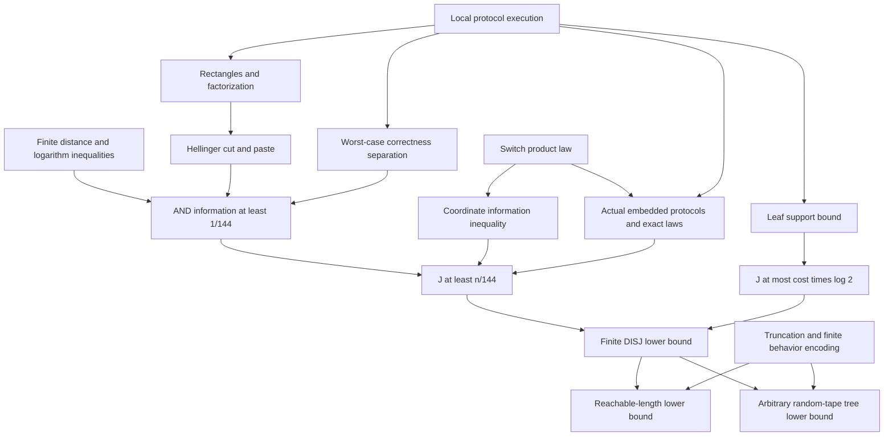

# BJKS proof correspondence

The complete information argument and public-output tree-model communication
lower bound are checked. `status.md` gives a review index and `audit.md` states
the exact scope. This document describes proved results, not assumed axioms.

## Statement and model

For `Bits n := Fin n → Bool`, `disj x y` is true iff no coordinate is true in both
inputs. For every finite-seed protocol with worst-case error at most `1/3`,

`(1 / (144 * log 2)) * n ≤ cost Π`.

The coefficient is positive, independent of all input dimensions, laws, and seed
cardinalities. Dimension zero is included. `finiteLowerBoundClaim` proves the
original existential target with `n₀ = 0`.

A tree node is either a public Boolean leaf, an Alice node with an arbitrary
Alice-local Boolean decision, or a Bob node with a Bob-local decision. Each edge
transmits one bit. A public seed selects the tree, while independent private seeds
are included in the players' local inputs. There is no restriction on interaction,
local computation, or the amount of finite randomness.

`ReachableCost.lean` trims unreachable deep branches without changing any execution
within a stated length bound. `RandomTape.lean` groups arbitrary random tapes by a
finite bounded behavior code and preserves error via an exact measure pushforward.
Its endpoint allows arbitrary probability spaces and assumes measurability of the
bounded behavior. Public leaf output remains the chosen convention.

## Distribution and information

Each coordinate has a fair hidden analysis switch. A false switch fixes Alice's
bit to zero and samples Bob's bit fairly; a true switch reverses the roles.
The resulting marginal masses for `00,01,10,11` are `1/2,1/4,1/4,0`.
`Switch.law_map_triples` proves independent coordinate triples, and the conditional
laws give both player and coordinate independence. Every supported input is disjoint.

The protocol never receives these switches. Its external conditional information
is the actual PFR quantity `J = I((X,Y);T | D,R)` in nats. Leaf support bounds on
individual public-tree fibers give `J ≤ cost * log 2` with no public-seed entropy
charge. Null public seeds contribute zero.

`FiniteView.lean` represents a view as a public seed paired with a leaf path.
`informationCost_eq_channel` proves `J = I((X,Y);(R,T) | D)` in a finite channel
presentation, using independence to move `R`. All subsequent channel calculations
therefore concern the original execution information.

## AND argument

The squared distance is `h²(P,Q) = (1/2) Σ(√P-√Q)²`.
`Hellinger.lean` proves the following facts directly from finite real masses:

1. Squared triangle: `h²(P,R) ≤ 2 h²(P,Q) + 2 h²(Q,R)`.
2. The transcript rectangle identity implies `h²(L00,L11) = h²(L01,L10)`.
3. Total variation satisfies `TV² ≤ 2 h²` and bounds every event-probability difference.
4. A scalar logarithm inequality gives `h²(P,Q) ≤ 2 JS(P,Q)`.

`BinaryInformation.information_fair` (namespace `Disjointness.Channel`) identifies
`JS` with PFR mutual information of a fair binary selector. Averaging the two switch
branches yields

`h²(L00,L11) ≤ 8 J_AND`.

Correctness of the joint public-seed/transcript laws gives `TV(L00,L11) ≥ 1/3`,
including correctness at the zero-analysis-mass input `11`. Consequently
`J_AND ≥ 1/144` nats. This is `Protocol.and_information_lower_bound`.

## Coordinates and actual embeddings

`condEntropy_vector_le` proves finite-vector conditional entropy subadditivity.
Together with PFR entropy additivity for independent coordinates it gives
`bjksInformationCost_ge_sum_coordinates`.

For each coordinate and fixed padding-switch vector, `Protocol.embed` is an actual
AND protocol. It samples independent switch-conditioned private padding, inserts
the actual two input bits at the distinguished coordinate, executes the original
DISJ protocol, and negates the leaf output. Its communication is unchanged.
The selected-coordinate padding is overwritten; the selected hidden switch is
never available to the protocol.

Holding the other switches as public parameters and averaging afterward is the
implemented version of publicly sampling the padding switches. It avoids a larger
public-seed type while proving the same averaged inequality. `embed_correct`
checks all four inputs. `inputLaw_fill` and `joint_fill_channel` establish exact
product and joint laws. `embed_informationCost` identifies the embedded cost as
the average of the two selected-switch coordinate terms. `average_resample`
proves that averaging this identity preserves the full switch average.

Applying the AND bound to every embedded protocol and summing gives
`Protocol.bjks_information_lower_bound : n / 144 ≤ J`.
The upper bound on `J` yields `disjointness_lower_bound` by division by `log 2`.

## Dependency map

## Scope boundaries

No protocol is assumed to possess the lower-bound properties it needs.
Factorization, support, independence, information comparisons, correctness of
embeddings, and distribution identities are proved. The final axiom audit contains
only Lean's ordinary foundational axioms.

The public-output local-tree models are explicit. Translation from another
machine syntax and the additional-bit conversion for private-only output are not
part of this theorem package. Neither are almost-sure or expected communication
bounds. See the final audit before comparing to a differently defined complexity measure.
